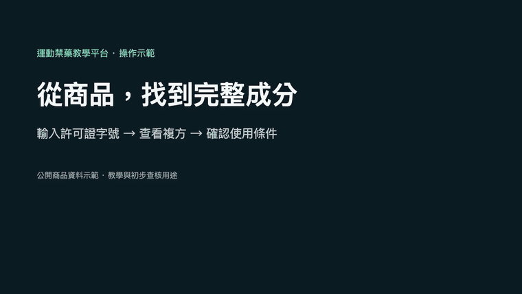

# 運動禁藥教學平台

給選手、教練與醫療人員的繁體中文工具：查台灣西藥成分、閱讀禁藥案例，練習用藥與 TUE 情境判讀。

**[開啟網站](https://antidopingplatform.sportsmedicine.tw/) · [直接查西藥](https://antidopingplatform.sportsmedicine.tw/drug-search) · [English](README.en.md)**

[](https://antidopingplatform.sportsmedicine.tw/drug-search)

無須註冊即可體驗。教學與初步查核用途；查無資料或條件未明不代表可用，結果不能代替正式用藥查證或 TUE 核准。

## 可以做什麼

| 入口 | 可以完成的事 |
| --- | --- |
| [西藥查詢](https://antidopingplatform.sportsmedicine.tw/drug-search) | 以中英文商品名、成分或許可證字號查詢；展開完整成分，選擇給藥途徑、運動項目與日期，查看賽內／賽外條件 |
| [案例搜尋](https://antidopingplatform.sportsmedicine.tw/cases) | 依項目、年份、物質等條件找案例，閱讀事件脈絡與來源 |
| [TUE 工具](https://antidopingplatform.sportsmedicine.tw/tue?tab=tools) | 練習判斷需要進一步確認的用藥與治療用途豁免情境 |
| [角色學習](https://antidopingplatform.sportsmedicine.tw/learning) | 使用選手、教練、醫療人員的任務清單與測驗 |
| [來源中心](https://antidopingplatform.sportsmedicine.tw/sources) | 查看教育內容的來源、版本及待核對狀態 |

**商品查詢只提供西藥。** 中藥／營養品的查詢入口已移除；[補充劑安全教育](https://antidopingplatform.sportsmedicine.tw/education?tab=supplements)仍保留。舊中藥與食品快照留供離線研究，不會在正常建置中發布。

### 先試一筆

到西藥查詢輸入 `衛署藥製字第056706號`，開啟商品明細，查看複方成分，再設定實際使用條件。頁面底部保留「前往 TADA 核對商品」連結。操作示範使用公開商品資料，沒有病人資料或個人用藥紀錄。

## 在本機執行

需要 Git、**Node.js 22.13.0 以上**及 npm。首次安裝需要網路；Wrangler 已鎖定在專案依賴中。此快速開始不需要 Cloudflare 帳號、API key、`.env` 或 MongoDB。

```sh
git clone https://github.com/keanu77/antidopingplatform.git
cd antidopingplatform
npm ci
npm --prefix frontend ci
npm run cf:build
npx --no-install wrangler pages dev frontend/dist --ip 127.0.0.1 --port 8788
```

開啟 **http://127.0.0.1:8788**。這會同時啟動前端與 Pages Functions API。第一次西藥查詢需要載入搜尋索引。修改前端後重新執行 `npm run cf:build`；停止伺服器使用 `Ctrl+C`。

上述步驟已在全新 Ubuntu 24.04 環境實跑；[安裝驗證紀錄](docs/launch/verification.md)列出環境與檢查範圍。

若要在本機測試回饋儲存，先在另一個終端執行 `npm run cf:migrate`；它預設只建立／更新本機 D1。單純瀏覽、查藥與教學不需要這一步。請使用虛構測試內容，不填病人資料。

只啟動 Vite 不會提供目前正式站的 API；`npm run dev` 啟動的是保留的 Express／MongoDB 舊架構。開發、常見問題與驗證指令見[開發指南](docs/development.md)。

## 架構與資料位置

```text
frontend/                 React 19、Vite、Tailwind；瀏覽器內的西藥搜尋
functions/                Cloudflare Pages Functions API
data/cases.json           教學案例
data/drugs/               TFDA 西藥快照與來源 manifest
backend/data/             共用教育內容、成分規則與查核資料
shared/                   來源有效性與規則年份檢查
scripts/                  資料匯入、建置、更新與驗證
docs/                     維護說明與歷史查核紀錄
```

正式站使用 Cloudflare Pages 與 Pages Functions。案例、教育與 TUE 的讀取資料在建置時編入；西藥索引由版本控制中的快照生成。**D1 僅用於回饋與寄送狀態，不是西藥資料庫。** Express／MongoDB 程式保留作舊架構與整合測試用途。

西藥更新每月產生候選快照、差異與品質報告，經審核後才另版發布；可設定為每季。WADA 規則仍需年度審核，不會因更新商品資料而自動延長有效期。見[西藥資料維護](docs/drug-maintenance.md)。

## 資料來源與使用範圍

西藥商品與成分取自 TFDA 開放資料，規則保留來源及查核狀態。這是獨立建立的查詢工具，並非 TADA 原始資料庫或官方核准服務；名稱對照比例也不是判讀準確率。

案例包含違規、污染、合法 TUE 與撤銷等情境，不能把案例數當作違規人數。原有查核紀錄完整保存在[案例查核歷史](docs/data-review-history.md)與[西藥研究紀錄](docs/research/2026-10-23-drug-system/README.md)。

程式碼沿用專案既有的 [MIT 授權](LICENSE.md)。第三方資料、規則文件、引用內容與品牌各依其原始條款；詳見[資料來源與授權範圍](docs/data-sources.md)。

## 參與與維護

- 功能建議、介面問題與附來源的資料勘誤：[提出 issue](https://github.com/keanu77/antidopingplatform/issues/new)、[貢獻指南](CONTRIBUTING.md)。
- 資安問題與憑證外洩：[私密回報](https://github.com/keanu77/antidopingplatform/security/advisories/new)、[安全政策](SECURITY.md)。
- [更新紀錄](CHANGELOG.md)、[回饋與發布維運](docs/feedback-operations.md)、[最新查詢範圍驗收](docs/research/2026-10-23-drug-system/western-only.md)。

部署流程會驗證版本、建置、API 與桌機／手機瀏覽器操作。這些工程檢查不代表臨床簽核或真實使用者研究。
